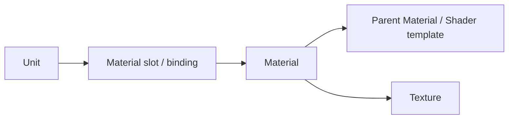

# HD2 Patch 材质与贴图引用读取设计

**日期：** 2026-07-14  
**状态：** 读取基线、无改写拆分/合并和 Manager 高级详情打包入口已完成；稳定 Mod facts SQLite、Profile winner-first 材质诊断和高级 AssetKey 表已接入。导入事务化、旧摘要缓存清理和完整有效资源图投影仍待完成。  
**适用项目：** `HD2ModAdaptation`、`HD2ModCore`、`HD2ModManager`

---

## 1. 目的与边界

本文固定 HD2 Patch 中模型、材质和贴图的读取事实，以及后续配置文件诊断应采用的计算规则。

目标是让 Manager 能在**保持平铺 Mod 模型**的前提下：

1. 确认 `Unit → Material → Texture` 的真实 AssetKey 引用；
2. 判断当前 Profile 的最终有效 Unit、Material、Texture；
3. 提示缺失材质、缺失贴图、直接覆盖与连带不可达资源；
4. 让仅含 Material/Texture 的外置材质 Mod 通过 Mod 内 Unit 的反向引用获得语义目标；
5. 为后续“内嵌材质拆分”与“模型+材质合并”提供不修改引用的事实基础。

无改写写出可行性、验证门槛和 smoke 流程见 [material-texture-packaging-smoke-plan.md](material-texture-packaging-smoke-plan.md)。其 P0–P4 已用两类真实样本完成：

1. 原本内嵌 Material/Texture 的 Mod：拆分、重新合并、游戏和 Blender 均通过；
2. 原生平铺的“模型 Mod + 后置材质变体 Mod”：显式选择材质 winner 后合并、游戏和 Blender 均通过。

两组真实 smoke 与 Manager 验收均已通过，因此最小材质打包功能已接入产品。当前下一阶段是 Profile 最终有效资源图与诊断；不在此阶段加入材质编辑或复杂作者工作流。

### 1.1 不做的事

第一阶段不得：

- 根据 Mod 名、目录名、文件名推测依赖或归属；
- 建立父子组件、必选组件或复杂 Mod 层级；
- 强制模型 Mod 与材质 Mod 的相对排序；
- 将“Patch 中 Material 数量”当作材质完整性证明；
- 让 Manager 运行 Blender 或完整 Python SDK；
- 将未验证的资源类型依赖静默视为完整。

---

## 2. 已确认的资源模型

Patch 资源以 AssetKey 定位：

$$
\operatorname{AssetKey}=(\operatorname{TypeId},\operatorname{FileId})
$$

当前确认的核心类型：

| 资源 | TypeId |
| --- | --- |
| Unit | `0xe0a48d0be9a7453f` |
| Composite Unit | `0xc4f0f4be7fb0c8d6` |
| Material | `0xeac0b497876adedf` |
| Texture | `0xcd4238c6a0c69e32` |

每个 Patch entry 有三段 Payload：

```text
TocData             资源结构、引用表、元数据
StreamData          可选流式数据
GpuResourceData     可选 GPU 数据
```

Patch 的 `.patch`、`.stream`、`.gpu_resources` 必须视为同一个 Patch 文件组，不能只以主 `.patch` 文件判断资源是否完整。

### 2.1 可见模型引用链



其中：

- Unit 的 Mesh section 先使用 32 位材质槽位；
- Unit 根部 Material 表把槽位绑定到 64 位 Material FileId；
- Material 的 Texture 表引用 64 位 Texture FileId；
- Parent Material 通常是原版 Game Data 中的 Shader/模板依赖，不应在第一版自动复制或移动。

---

## 3. 读取证据与唯一实现来源

### 3.1 Patch entry 与 Payload

唯一的 Patch entry 扫描与 Payload 读取基础：

- `PatchTocScanner`：扫描 TOC entry 和 entry metadata；
- `PatchEntryPayloadReader`：按 TOC offset 读取三段 Payload。

不得为 Profile 诊断新增第二套 TOC/sidecar 读取器。

### 3.2 Unit → Material

SDK 3.8.0 的 Unit header 中：

| 字段 | TocData 相对偏移 |
| --- | ---: |
| `MaterialsOffset` | `0x70` |

`MaterialsOffset` 指向的根部 Material 表布局为：

```text
uint32 count
uint32 sectionIds[count]
uint64 materialIds[count]
```

读取结果应投影为：

```text
UnitMaterialBinding
  SectionId: uint32
  MaterialId: uint64
```

当前完整 `UnitMeshReader` 已实现该读取。后续 Profile 大批量依赖扫描应新增一个轻量、只读取上述 binding 表的 `UnitMaterialReferenceReader`，避免为依赖图读取 Mesh、RawMesh 和 GPU 顶点数据。

轻量读取器必须复用同一已确认布局，并执行：

- Header 最小长度检查；
- `MaterialsOffset` 非零检查；
- count overflow 检查；
- `sectionIds + materialIds` 范围检查；
- 零 MaterialId 过滤或结构化记录。

### 3.3 Material → Texture

Material 的 Texture 表当前由 `StingrayMaterialReferenceReader` 读取：

| 字段 | TocData 相对偏移 |
| --- | ---: |
| `textureCount` | `0x40` |
| Texture 元数据表起点 | `0x88` |
| 每个元数据记录长度 | 4 bytes |
| Texture ID 表 | `0x88 + textureCount * 4` |

Texture ID 表为 `uint64 textureIds[textureCount]`。

此实现应继续作为唯一 Material → Texture 读取来源。不得以字符串、DDS 文件名或 Patch 中 Texture 数量猜测引用。

### 3.4 证据定位

后续稳定 facts 必须为每条依赖边保存可审计证据：

```text
Source AssetKey
Target AssetKey
RelationKind
Source Patch Group
PayloadRelativeOffset
Optional SlotId / TextureIndex
```

绝对 Patch 文件位置可按下式计算：

$$
\operatorname{AbsolutePatchOffset}
=
\operatorname{Entry.TocDataOffset}
+
\operatorname{PayloadRelativeOffset}
$$

普通 UI 不展示全部偏移；高级详情可按需展示。

---

## 4. Profile 最终有效资源图

Profile 仍是有序、平铺的 Mod 列表。材质 Mod 与模型 Mod 均为普通 Mod。

### 4.1 AssetKey winner

对当前 Profile 中每个提供的 AssetKey：

$$
\operatorname{Winner}(A)
=
\text{按实际部署顺序最后提供 }A\text{ 的 Mod/patch group}
$$

所有 Patch AssetKey 都必须参与 winner 计算，包括原版 Game Data 中不存在的私有 Material 和 Texture。

原版 Archive 映射是可选的业务元数据，不能作为“是否进入覆盖链”的前置条件。

### 4.2 有效引用图计算顺序

必须按以下顺序计算：

```text
1. 收集 Profile 全部提供者，确定每个 AssetKey winner。
2. 仅读取最终有效 Unit winner 的 Unit → Material 边。
3. 对被这些 Unit 引用的每个 Material，选择最终有效 Material winner。
4. 仅读取最终有效 Material winner 的 Material → Texture 边。
5. 对每个 Texture，选择最终有效提供者，或确认其来自 Game Data。
6. 从最终有效 Unit roots 进行可达性遍历。
```

**禁止**将所有 Mod、所有被覆盖 Unit 或所有被覆盖 Material 的引用边直接求并集。

原因是被覆盖的红色 Material 虽仍存在于 Profile 输入中，但其 Texture 已不应被视为当前有效引用。

### 4.3 可达性

令最终有效 Unit roots 为 $U_{\mathrm{effective}}$，最终有效引用边为 $E_{\mathrm{effective}}$：

$$
R=\operatorname{Reachable}(U_{\mathrm{effective}},E_{\mathrm{effective}})
$$

对当前阶段，仅将以下类型参与“无有效引用”诊断：

```text
Unit → Material → Texture
```

未知类型或尚未实现的引用类型不能被自动标为无效。

---

## 5. 诊断规则

### 5.1 Unit 缺失 Material

若最终有效 Unit 引用 Material `M`，且：

- 当前 Profile 无 `M` winner；
- Game Data 也不存在 `M`；

则报告：

```text
MissingMaterial
```

若 Mod 库存在提供 `M` 的其他普通 Mod，可显示为候选修复；候选依据只能是 AssetKey 精确匹配。

### 5.2 Material 缺失 Texture

若最终有效 Material 引用 Texture `T`，且：

- 当前 Profile 无 `T` winner；
- Game Data 也不存在 `T`；

则报告：

```text
MissingTexture
```

### 5.3 直接覆盖

若一个 Mod 提供的 AssetKey 被同一 Profile 后续 winner 取代，则该 AssetKey 是直接覆盖。

现有 `ProfileOverrideGraph`、`ProfileModCoverage`、`PartiallyOverridden`、`FullyOverridden` 是该结论的唯一来源，应增强而非另建并行系统。

### 5.4 无有效引用 / 不可达资源

若 Material 或 Texture 在当前 Profile 中存在，但不属于 $R$，则它在当前 Profile 中无有效引用。

典型情况：

```text
Red Materials Mod:
  Material M → Texture R1/R2/R3

Blue Materials Mod:
  覆盖 Material M
  Material M → Texture B1/B2/B3
```

最终：

```text
Material M (Red)       直接被覆盖
Texture R1/R2/R3       因唯一上游 Material 被覆盖而不可达
```

用户可看到聚合状态：

```text
异常：被后续材质变体覆盖
```

高级详情必须解释因果链：

```text
直接覆盖：Material M 被 Blue Materials 覆盖
连带不可达：Texture R1、R2、R3 无最终有效 Material 调用方
```

不要将这种情况称为“缺失引用”；资源未丢失，问题是最终有效图中没有到达它的路径。

### 5.5 外置材质包无有效 Unit 调用方

若外置材质 Mod 提供 Material，但当前 Profile 的最终有效 Unit 不再引用它，应报告：

```text
NoEffectiveUnitConsumer
```

文案应为：

```text
未发现有效 Unit 使用此材质
```

而不是在只支持 Unit/Material/Texture 链时宣称所有可能资源类型都绝对不会引用它。

若库中存在 Unit 精确引用该 Material 的 Mod，可以展示候选调用方，但不自动建立组件或父子关系。

---

## 6. Mod 私有资产的语义目标

外置材质包中的私有 Material/Texture 常不在原版 Game Data 中，因此没有原版 Archive 标签。它们仍可通过反向引用获得目标语义：

```text
Material M
← Unit U
← Unit U 由某 Mod 提供
```

该 Material/Texture 的目标可以展示：

```text
调用方 Mod 名 / Unit AssetKey
```

若调用方 Unit 能映射至原版护甲或头盔，则可额外派生 `armor`、`helmet` 等搜索标签。

内部数据必须区分来源：

```text
AssetTargetSourceKind
  GameArchive
  Mod
```

Mod 名不能伪装成真实 Game Data archive ID。UI 可统一显示“目标”，高级详情必须显示来源为 Mod。

建议将标签分为：

```text
DirectTags
  material
  texture

ReferencedTargetTags
  armor
  helmet

ReferencedBy
  Mod 名 / Unit
```

搜索可联合使用；详情必须保留推导来源。

---

## 7. 持久化与性能边界

### 7.1 稳定 facts：SQLite

随着跨 Mod 引用增多，以下稳定事实应迁移至独立 `mod-facts.db`：

- Mod、Patch group 与 content generation；
- Patch AssetKey；
- entry payload metadata/fingerprint；
- `Unit → Material` 边；
- `Material → Texture` 边；
- 边的证据 offset；
- 解析 issue；
- provider/consumer 反向索引。

建议核心索引：

```text
mod_assets(type_id, file_id)
asset_references(target_type_id, target_file_id)
asset_references(source_type_id, source_file_id)
mod_assets(node_id)
patch_groups(node_id)
```

### 7.2 临时投影：内存或短期缓存

以下内容依赖当前 Profile 顺序，不作为长期权威事实：

- AssetKey winner；
- 覆盖比例；
- 缺失 Material/Texture；
- 无有效引用；
- 当前候选修复方案。

它们应由 SQLite 稳定 facts 加当前 Profile revision 快速重算。可按 `ProfileRevision + FactsGeneration` 缓存，但不能脱离这两个版本复用。

### 7.3 JSON 的保留范围

继续使用 JSON 保存：

- Mod 用户元数据；
- Profile；
- notes；
- manifest；
- activation state；
- 小型可读配置。

现有每 Mod 一个 JSON 的资产分析缓存不应继续承担跨 Mod 图查询职责；迁移时应保留可重建策略与版本失效规则。

---

## 8. 实施顺序

1. 在 `HD2ModAdaptation` 提供轻量 `UnitMaterialReferenceReader`；
2. 扩展 patch group 分析契约，保存 Unit/Material 引用边与证据；
3. 保持隔离 `MaterialPackagingSmoke` 的容器回读、三段 Payload hash、图等价和真实游戏/Blender 验证；
4. 修改现有 `ProfileOverrideGraph`：所有 Patch AssetKey 都参与 winner；**已完成。**
5. 在 Core 中基于 winner Payload 构建有效资源图、缺失与可达性诊断；
6. 在 Manager Profile 列表和高级详情展示异常、覆盖与因果链；
7. 将稳定 Mod asset/reference facts 从当前版本化 JSON cache 迁移至独立 SQLite；
8. 最后才考虑一键推荐、批量操作、材质编辑或其他高级作者工作流。

### 8.1 2026-07-15 稳定事实收敛进展

已完成以下收敛，作为后续性能与诊断修复的基础：

1. `mod-facts.sqlite` 已保存 Patch group、AssetKey、`Unit → Material`、`Material → Texture` 和引用证据；
2. 当前 Profile 材质诊断直接读取已保存的 Mod facts，不因 Profile 刷新再次读取 Patch payload；
3. 高级 AssetKey 表的 Material 和 Texture 目标优先显示精确的 Mod 反向 Unit 调用链；Game Data 同 AssetKey 映射仅在没有该调用链时作为补充显示；
4. 普通详情在旧 `ModAssetSummary` 尚不可用但稳定内容事实已存在时，显示稳定 AssetKey 计数，不再一律显示“资产派生数据正在后台更新”；
5. 批量导入改为串行执行，避免多个导入同时争用库快照和同一 SQLite facts 数据库。

旧的按 Mod JSON `ModAssetSummary` 扫描与缓存链已删除。库卡片、搜索和配置列表的摘要改为由稳定 `ModContentFacts` 加可变 Game Data 映射投影生成；它们不再打开 Patch payload，也不因 Game Data 映射变化而使 Mod Patch facts 失效。

Core 导入器现在在新节点发布到 Manager UI 前触发稳定 Patch facts 持久化；facts 读取或写入失败时，会删除新建的只读 Mod 目录与对应 facts，并且不会发布新的库快照。Manager 只消费成功提交的导入结果。

下一步仍可进一步将当前直接写入最终库目录的复制阶段替换为临时 sibling 目录加原子目录改名，以缩小进程崩溃发生在复制中途时的恢复窗口。

---

## 9. Manager 高级详情页：最小材质打包功能

### 9.1 产品目标

材质打包仍以普通平铺 Mod 为输入和输出，不创建组件、父子 Mod、自动依赖关系或新的部署模型。

高级详情页只提供经过真实 smoke 验证的三类无改写操作：

| 输入 Mod 状态 | 操作 | 输出 |
| --- | --- | --- |
| 有内嵌 Material/Texture | `拆分内嵌材质` | 两个独立 Mod：模型包、材质包 |
| 有内嵌 Material/Texture | `用库中材质包生成替换版` | 一个新的内嵌材质 Mod |
| 无内嵌、但 Unit 引用外部 Material | `用库中材质包生成内嵌版` | 一个新的内嵌材质 Mod |

所有操作只生成新 Mod，绝不修改原 Mod、原库条目、原 Patch 文件组或当前 Profile。

### 9.2 入口与可用性

在单个 Mod 的高级详情中增加“材质打包”区域。按钮必须依赖已缓存的精确 AssetKey 图事实，不能依赖目录名、Mod 名、Patch 序号或资源数量。

```text
材质打包
  [拆分内嵌材质]
  [用库中材质包生成替换版]
  [用库中材质包生成内嵌版]
```

按钮可用规则：

| 按钮 | 可用条件 |
| --- | --- |
| `拆分内嵌材质` | 当前 Patch 至少提供一个 Material；引用闭包缺失、未知类型或无 Unit 仅显示提醒，不阻断 |
| `用库中材质包生成替换版` | 当前 Mod 存在内嵌 Material；用户选择的库 Mod 对至少一个当前有效 Unit Material 提供精确同 AssetKey winner |
| `用库中材质包生成内嵌版` | 当前 Mod 存在 Unit 外部 Material 依赖；用户选择的库 Mod 至少提供一个精确匹配 Material |

候选完全不匹配 Material 时禁止确认。缺失 Texture、未覆盖的外部 Material、未知资源或解析问题只显示提醒，例如：

```text
提醒：Material M 引用的 Texture T 不在源或候选 Patch 中；将保留外部引用。
提醒：候选材质包未覆盖 Unit U 的 Material M；将保留外部引用。
提醒：存在未知资源类型；它会保留在模型包，无法确认是否间接引用材质资源。
```

### 9.3 候选材质包选择

点击“用库中材质包生成替换版”或“生成内嵌版”时，弹出库内普通 Mod 选择器，而非文件系统浏览器。

候选项必须显示：

```text
Mod 名
可覆盖 / 可满足的 Material AssetKey 数
缺失 Material 数
缺失 Texture 数
是否通过完整适配检查
```

默认优先显示完整适配候选。只要至少精确匹配一个 Material，缺失项会显示为“可写出（提醒）”；只有完全没有匹配 Material 的候选不能确认。

候选匹配规则：

1. 从源 Mod 的有效 Unit 读取 `Unit → Material`；
2. 仅以 Material `AssetKey` 精确匹配库中候选 Mod 的提供者；
3. 对候选 winner Material 读取 `Material → Texture`；
4. 确认每个需要内嵌的 Texture 都由候选 Mod、保留源 Mod 或允许保留的原版资源提供；
5. 不以名称、预览图、目录相邻关系或颜色描述推断“适配”。

“完整适配”不表示候选 Mod 必须覆盖源 Unit 的全部 Material。它表示：**候选 Mod 想要替换或补齐的每个 Material 都有完整、可验证的 Texture 闭包。** 不完整并不禁止写出：实际 Mod 常遗漏不可见部件资源，输出会原样保留无法解析的外部引用，并在 UI 中明确提醒。

这允许常见的部分颜色变体：候选材质包只覆盖两个 Material，输出仍保留源模型包中其余未被覆盖的内嵌 Material。

### 9.4 三种写出语义

#### A. 拆分内嵌材质

输入为单个内嵌 Mod。先生成保守拆分计划：

```text
模型包
  Unit 与全部非移动 entry

材质包
  从模型 Unit 可达、且源 Mod 内提供的 Material
  上述 Material 可达、且源 Mod 内提供的 Texture
```

输出是两个普通、独立可导入的 Mod。模型包单独启用时可以显示 `MissingMaterial`；材质包单独启用时可以显示 `NoEffectiveUnitConsumer`。两者按任意正常 Profile 顺序共同部署后，其最终 winner 图必须与原内嵌 Mod 等价。

#### B. 内嵌 Mod + 选定材质包 → 替换版内嵌 Mod

输入为：

```text
源内嵌 Mod
库中用户明确选定的材质包 Mod
```

输出以源内嵌 Mod 为基础。对选定材质包提供的同 AssetKey Material，材质包是显式 winner：

```text
源 Unit
  → 保留原 binding
  → 选定材质包的同 AssetKey Material
  → 选定材质包的 Texture closure
```

源 Mod 中被选定 winner 取代的旧 Material 与仅被这些旧 Material 引用的旧 Texture 不得混入输出。未被候选包覆盖的源内嵌 Material/Texture 必须保留。最终输出图必须等价于：

```text
源内嵌 Mod + 选定材质包 Mod（材质包后序 winner）
```

#### C. 非内嵌 Mod + 选定材质包 → 内嵌版 Mod

输入为：

```text
源模型 Mod（Unit 引用外部 Material）
库中用户明确选定的材质包 Mod
```

输出保留源模型 Mod 的 Unit 和非材质资源，并嵌入所需的 Material/Texture 闭包。只有在以下条件都成立时才允许确认：

1. 每个待内嵌 Unit Material 都能由源 Mod 或选定材质包解析；
2. 每个选定 Material 的 Texture 闭包完整；
3. 不需要改写 Unit binding、Material Texture ID、AssetKey 或 Payload；
4. 不存在未知私有依赖或冲突 winner。

输出图必须等价于：

```text
源模型 Mod + 选定材质包 Mod（材质包后序 winner）
```

### 9.5 共同写出不变式

三种操作共享以下绝对约束：

```text
AssetKey 不变
TocData 不变
StreamData 不变
GpuResourceData 不变
Unknown1..4 不变
```

允许变化的仅为新 Patch 容器内的 type table、entry table、entry index、payload offset 和 64-byte sidecar 对齐填充。

每次写出后自动执行：

1. `PatchTocScanner` 与 `PatchEntryPayloadReader` 回读；
2. 所有搬运 entry 的三段 SHA-256 恒等；
3. 输出 AssetKey 集合与批准计划一致；
4. 以最终 winner 规则比较 `Unit → Material → Texture` 图；
5. 失败时保留诊断产物，但不将输出标记为可导入。

### 9.6 输出与导入

在写出确认页提供两个互斥目标：

```text
○ 输出到用户选择的空文件夹
○ 写出并自动导入 Mod 库
```

共同规则：

- 默认输出名由源 Mod 显示名加操作后缀构成，例如“模型”“材质”“内嵌版”“替换材质版”；
- 生成 Patch 文件组时保留原 archive hash 基名，由 Manager 部署时分配实际 Patch 序号；
- 输出目录必须为空或由本次操作新建；不允许覆盖已有内容；
- 自动导入只在全部离线验证成功后执行；
- 自动导入结果是普通平铺 Mod，不自动加入当前 Profile；
- 拆分操作自动导入时产生两个独立库 Mod；其命名仅用于显示，不构成持久组件关系；
- 写出完成页展示输入 fingerprint、批准计划、输出路径、hash 验证和图等价摘要。

### 9.7 本阶段明确不做

- 不在 Manager 中编辑 Material 参数、Shader variable、Parent Material 或 Texture；
- 不重新编码/压缩 Texture；
- 不生成新的 Material 或 Texture ID；
- 不自动选择“看起来像”适配的材质包；
- 不批量拆分、批量替换或批量自动导入；
- 不自动改变 Profile 顺序；
- 不将一次写出结果当成原始 Mod 的覆盖更新。

---

## 10. 验收标准

- 外置材质包能够通过 Mod Unit 反向引用显示目标 Mod 名；
- 两个变体 Material 提供同一 AssetKey 时，后序 winner 正确；
- 被覆盖 Material 的独有 Texture 被标为“无有效引用”，而不是错误标为已引用；
- 被覆盖 Unit 的旧 Material/Texture 同样会连带不可达；
- 缺失 Material 与缺失 Texture 有不同诊断；
- 不存在原版映射的私有 AssetKey 仍参与 winner 与覆盖统计；
- Profile 改排序时不重新扫描 Patch payload；
- 不以文件名、目录名或资产数量推导依赖；
- 所有高级诊断能定位到具体 AssetKey、Patch group 与引用证据。
- 高级详情仅在候选没有任何精确 Material 匹配时禁止确认；缺失依赖显示为提醒并保留原始外部引用；
- 三种材质打包操作都不改写搬运资源的三段 Payload；
- 内嵌替换版和非内嵌内嵌版均与“源 Mod + 用户选定材质 winner”的最终有效图等价；
- 写出失败或验证失败时，不导入 Mod 库，也不影响源 Mod 和当前 Profile；
- 自动导入的拆分结果仍是两个普通、可独立管理的 Mod。
